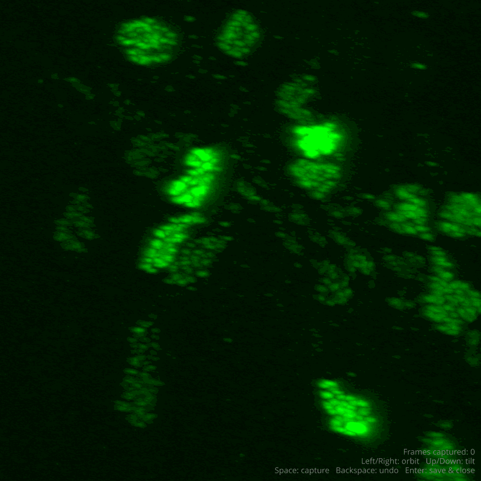
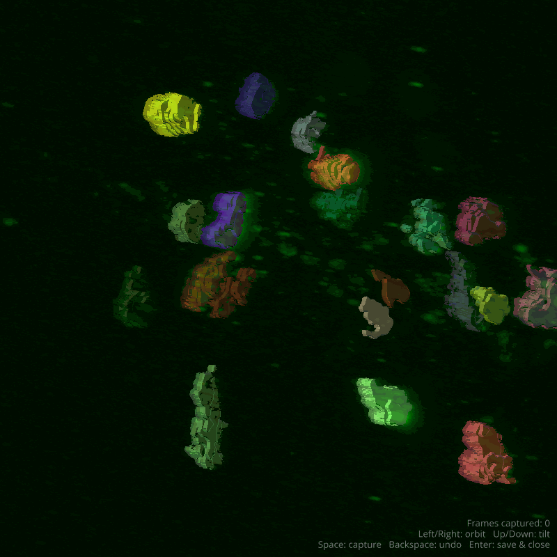
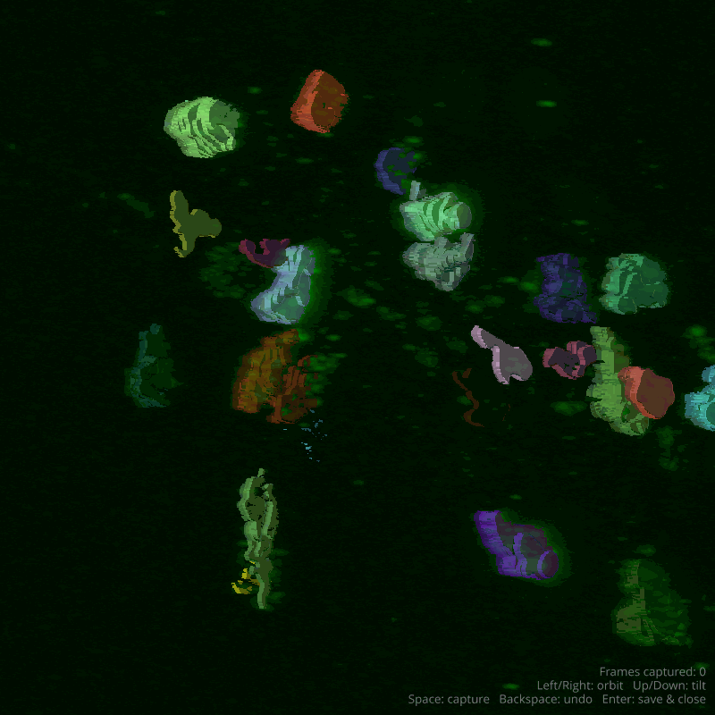

<div align="center">

# 🧠 Microglomeruli Segmentation

### Instance segmentation of synaptic boutons in *Drosophila melanogaster* brains from fluorescent confocal microscopy

[](https://www.python.org/)
[](https://pytorch.org/)
[](#license)

</div>

---

## What this is

This repository contains the training, inference, and evaluation code for my thesis on segmenting **microglomeruli** — synaptic bouton structures — in confocal microscopy volumes of the *Drosophila* brain. Several segmentation backbones are trained and compared: **MicroSAM**, **Cellpose 3D**, **nnU-Net v2**, and **SwinUNETR**.

## Sample results

A MicroSAM (`vit_l_lm`) model fine-tuned on this data, run on a held-out volume:

<div align="center">

| Raw input | Ground truth | Prediction |
|:---:|:---:|:---:|
|  |  |  |

</div>

## Overview

Models are trained on image/mask `.tif` slices (or volumes for the 3D pipelines) across several preprocessing variants of the same underlying dataset, and evaluated with instance-matching metrics.

| Dataset key | Description |
|---|---|
| `all` | Full combined dataset |
| `dog` | Difference-of-Gaussians preprocessed |
| `original` | Unprocessed raw images |
| `psf` | PSF-deconvolved images |

## Repository layout

```
Training_code/
  training_microsam.py          # MicroSAM (vit_l_lm) fine-tuning, 2D, with Kornia augmentations
  training_microsam_continual.py
  train_microsam_base.py
  training_cellpose3d.py        # Cellpose 3D training
  training_cellpose3d_xyz.py
  nnunet_training.py            # nnU-Net v2 training wrapper
  swinunetr_training.py         # SwinUNETR 3D training (MONAI)
  prepare_nnunet_dataset.py     # Converts TIFFs -> nnU-Net's NIfTI dataset format
  run*.sh, *.sub                # Shell / HTCondor job launch scripts (LFB cluster)
  inference/                    # Batch inference scripts + notebooks per model
tools/
  evaluate_segmentation.py      # Instance-matching evaluation metrics
  czi2tif.py                    # Zeiss .czi -> .tif conversion
  images_2_slices.py            # Volume -> 2D slice extraction
  annotate_img.py, visual_*.py, interactive_mask_viewer.py  # Annotation / visualization utilities
  downscale_*.py, shrink_mask.py, thresholding.py, region_growing.py, edge_detection.py  # Pre/post-processing utilities
  *.ipynb                       # Exploratory notebooks (data verification, diagnostics, seed detection)
weights/                        # Pretrained / fine-tuned model checkpoints
assets/gifs/                    # Sample input / ground-truth / prediction visualizations
```

## Setup

This project was developed across two machines, so two setup paths are supported:

**Mamba/conda** (annotation & visualization machine, napari-based tooling), defined in `environment.yml`:

```bash
mamba env create -f environment.yml
```

**pip** (training/inference machine), via `requirement.txt`:

```bash
pip install -r requirement.txt
```

`micro_sam` is not reliably published on PyPI — install it via conda/mamba instead (see comment in `requirement.txt`).

## Training

Each model has a dedicated training script under `Training_code/`. Most accept a `--dataset` flag selecting one of `all | dog | original | psf`, and a `--batch_size` flag.

Example — MicroSAM fine-tuning:

```bash
python Training_code/training_microsam.py --batch_size 1 --dataset all
```

On the LFB HTCondor cluster, training is launched via the corresponding `run*.sh` wrapper and `.sub` submit file, e.g.:

```bash
bash Training_code/run.sh all
```

Each training script expects data laid out as:

```
<DATA_ROOT>/train/images/*.tif
<DATA_ROOT>/train/masks/*.tif
<DATA_ROOT>/validation/images/*.tif   # optional — falls back to an auto split by brain volume
<DATA_ROOT>/validation/masks/*.tif
```

## Inference

Batch inference scripts live in `Training_code/inference/` (one per model backbone), alongside notebooks for interactive inspection of predictions.

## Evaluation

`tools/evaluate_segmentation.py` matches predicted instances to ground truth via linear sum assignment and computes per-dataset metrics (with physical voxel volume taken into account).

## License

MIT
